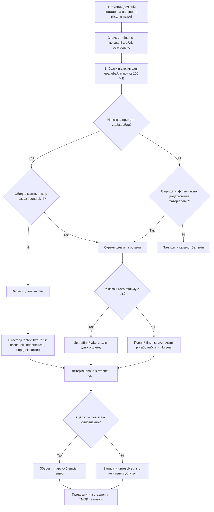

[До змісту документації](/uk/) · [Схема пакета](/uk/pages/flowchart/) · [Імпорт і очищення](/uk/pages/import-cleanup/)

Шаблони серіалів перевіряються раніше за наведені нижче шаблони фільмів. Дивіться [імпорт серіалів](/uk/pages/tv-shows/).

Виявлення каталогів починається після звичайних файлів. Кандидатами є лише безпосередні дочірні каталоги джерела. Кожен рекурсивно сканується командою `find -ls`; каталог призначення виключено. Для зіставлення з шаблонами підтримуваний медіафайл має бути **більшим за 100 MiB**.

Зв'язки субтитрів визначаються ще під час виявлення, до діалогів із моделлю. На схемі їх винесено після обох гілок, бо правила однакові. Номери частин призначаються після діалогу для двох частин.

Рік розпізнається на початку або в кінці основи назви файлу, перед розширенням, із підтримуваними роздільниками чи дужками. Два файли з однаковим роком проходять як дві частини. Так само, якщо року немає в одного чи обох. Різні роки виключають шаблон двох частин.

Окремі фільми всередині каталогів теж вибираються. Колекції, що не відповідають шаблонам серіалів чи двох частин, обробляються як окремі фільми, навіть без років у назвах. Відомі додаткові матеріали, зразки, трейлери та короткі сюжети не входять до цього маршруту. Увесь каталог усе одно займає одне місце в пакеті.

Лише вибраний фільм без розпізнаного року запускає діалог про відсутній рік. LLM отримує призначену назву файлу та повний `find -ls`, включно з іншими файлами, що можуть підказувати рік випуску. Вона повертає назву, припущений рік або **No year** (`null`), і впевненість. Часові позначки файлової системи не вважаються доказом року випуску.

Потім R3el шукає в TMDB за назвою і припущеним роком або без року, якщо LLM вибрала No year. Пошук із роком та рівно одним результатом переходить до імпорту. Інакше результати й список файлів із датами випуску кандидатів передаються LLM для окремого вибору. Пошук без року **завжди** використовує цей крок, навіть за одного чи нуля результатів. Модель може вибрати відсутність відповідності; невирішені елементи залишаються видимими. Звичайні повтори при нульовому результаті й пошук сусідніх років тут не застосовуються.

Зіставлення SRT спочатку шукає відповідну основу назви в тій самій папці, потім унікальну основу деінде в просканованому каталозі. Якщо назви різні, один відеофайл і один SRT у тій самій папці також можуть утворити пару. Кілька субтитрів до одного відео неоднозначні, адже нові імена зіткнуться. Такі випадки позначаються `unresolved_srt`; LLM не зіставляє субтитри.

Пріоритет форматів описано в [іменуванні файлів](/uk/pages/file-naming/). Поріг розміру використовується **лише для виявлення**; очищення перевіряє всі підтримувані медіафайли незалежно від розміру в усьому дереві джерела.
