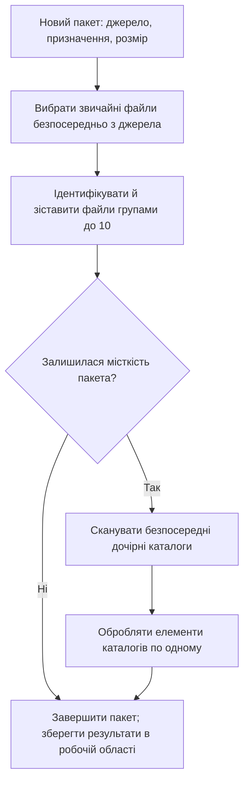
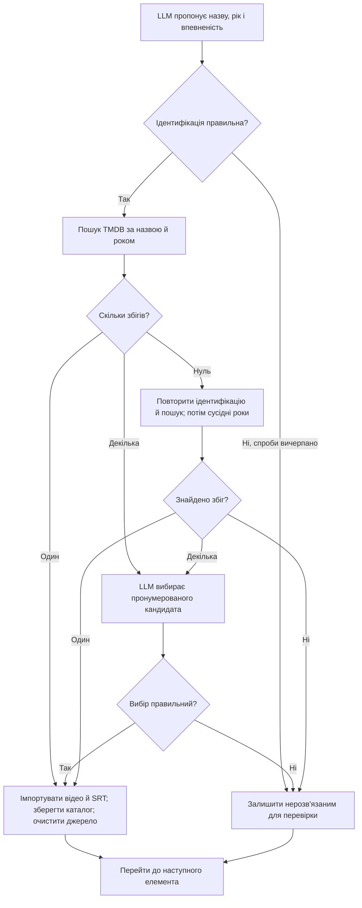

[До змісту документації](/uk/) · [Шаблони каталогів](/uk/pages/directory-patterns/) · [Імпорт і очищення](/uk/pages/import-cleanup/)

## Обробка пакета

Пакет починається, коли користувач обирає **New Batch**. R3el спершу працює з файлами безпосередньо в джерелі, а потім сканує безпосередні дочірні каталоги, які відповідають підтримуваним шаблонам. Типовий каталог призначення — `/exports/disk1/archive/media/movies`.

**Розмір пакета визначається кількістю вибраних елементів, а не рядків на екрані.** Один звичайний файл займає одне місце. Відповідний каталог теж займає одне місце, навіть якщо містить декілька фільмів. Каталоги, які не відповідають шаблонам, не змінюються. Вкладені каталоги враховуються під час сканування батьківського, але не додаються до черги окремо.

## Обробка окремого елемента

Звичайні файли й вибрані елементи каталогів проходять наведені нижче етапи ідентифікації та зіставлення. Кожен результат повертає керування пакету, щоб перейти до наступного елемента.

Діаграма об'єднує повтори для наочності. Для ідентифікації дозволено дві виправні спроби. За відсутності результатів TMDB можливі три нові ідентифікації; після них виконується пошук за попередній та наступний роки. Невирішені окремі елементи не заважають завершити пакет, але неочікувана помилка обробки може його зупинити.

Фільми в каталогах без року в назві мають окремий [сценарій визначення року](/uk/pages/directory-patterns/): LLM визначає рік за повним списком або вибирає No year, після чого R3el шукає в TMDB і за потреби передає результати на вибір. Пошук без року завжди вимагає вибору LLM і не використовує звичайні повтори після нульового результату.

**Stop Batch** завершує поточну операцію перед зупинкою. **Clear Current Batch** за потреби запитує зупинку, чекає звільнення робочої області й очищує робочі записи. Каталог, імпортовані файли та історія Event Log залишаються. **Current Task** показує останню подію пакета.

Докладніше: [шаблони каталогів](/uk/pages/directory-patterns/), [імпорт та очищення](/uk/pages/import-cleanup/) і [постійна робоча область](/uk/pages/file-states/).
