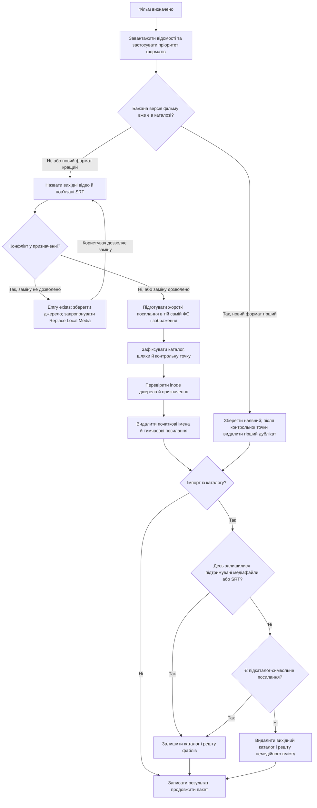

[До змісту документації](/uk/) · [Схема пакета](/uk/pages/flowchart/) · [Шаблони каталогів](/uk/pages/directory-patterns/)

Один збіг TMDB, прийнятий вибір LLM або ручний TMDB ID визначає фільм для імпорту. Його назва та рік випуску з TMDB визначають імена в каталозі призначення.

Переміщення відбувається через жорсткі посилання та `unlink` в **одній файловій системі**. **Байти відео не копіюються та не перечитуються для перевірки.** Джерело залишається до фіксації транзакції каталогу. Перевірки inode використовують метадані файлової системи, а не контрольні суми. Призначення на іншій файловій системі спричиняє помилку, а не приховане копіювання.

SRT переміщуються з пов'язаними відео й отримують однакову основу назви. Фільми з двох частин мають `Title (Year) Part 1.ext` і `Title (Year) Part 2.ext`; відповідні субтитри — такі самі основи з `.srt`. Дивіться [імена файлів](/uk/pages/file-naming/).

Очищення рекурсивно перевіряє каталоги будь-якої глибини. Відео підтримуваних форматів будь-якого розміру, невирішені SRT і символьні посилання на підкаталоги не дозволяють видалити джерело. Якщо такого вмісту немає, каталог можна видалити разом із нотатками випуску. Для папки з декількома окремими фільмами перевірка виконується після кожного імпорту, тож решта фільмів утримують її на місці.

На схемі показано успішний шлях і конфлікти призначення. Помилки файлової системи чи каталогу зберігають джерело до межі фіксації/видалення та записують помилку для перевірки. Видалення гіршого формату відрізняється від колізії точного шляху: остання вимагає явної команди **Replace Local Media**.

Дивіться [схему каталогу](/uk/pages/schema/) і [Control та Event Log](/uk/pages/control-server/).
