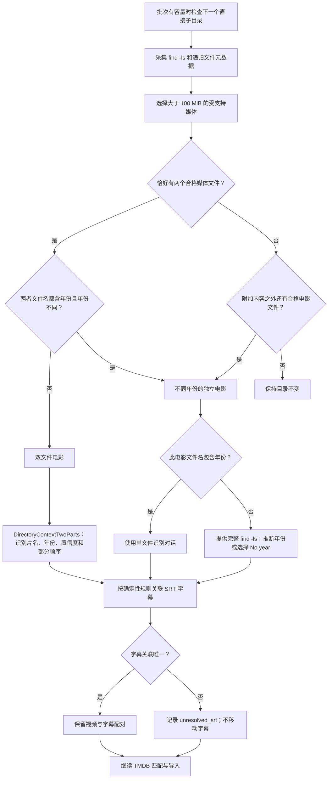

[返回文档目录](/zh-CN/) · [批次流程](/zh-CN/pages/flowchart/) · [导入与清理](/zh-CN/pages/import-cleanup/)

电视剧模式会优先于下列电影模式检查；详见[电视剧导入](/zh-CN/pages/tv-shows/)。

目录发现阶段在普通文件处理后运行。只有源目录的直接子目录可以作为候选项。每个候选目录通过 `find -ls` 递归扫描，目的目录被排除。参与模式匹配的媒体文件必须**大于 100 MiB**。

字幕配对在发现阶段、调用识别对话前确定。图中把它画在两条分支之后，因为它们使用同一组规则。双文件电影的部分编号在对应对话完成后指定。

年份可位于文件名主体的开头或结尾（扩展名之前），并支持特定分隔符或括号。两个文件年份相同时按双文件电影处理；只要一个或两个文件没有可识别年份，也走该流程。不同年份则排除双文件模式。

目录中的单独电影可以被选中。不符合电视剧或双文件模式的集合也会逐部处理，即使部分或全部文件名缺少年份。已识别的花絮、样片、预告片及制作特辑不进入此流程。整个目录依然只占一个批次名额。

仅文件名缺少年份的被选中电影会进入年份补全对话。LLM 获得已分配的文件名和完整 `find -ls` 列表，包括可提示上映年份的其他文件。模型返回片名、猜测年份或 **No year**（`null`），以及置信度。文件系统时间戳不能用来证明电影上映年份。

R3el 按片名和猜测年份查询 TMDB；若模型选择 No year，则不限制年份。带年份的搜索恰有一个结果时直接导入。其他情况下，系统将结果、目录列表和候选上映日期交给 LLM 另作选择。无年份搜索**始终**进入该选择步骤，包括只有一条结果或零结果。模型可以选择不匹配；未解决条目会显示在界面上。这里不执行普通零结果识别重试或相邻年份搜索。

SRT 关联先匹配同一文件夹中的相同主文件名，再尝试扫描目录其他位置的唯一同名文件。如果名称不符，但同一文件夹只有一个视频和一个 SRT，也可以配对。多个字幕指向同一个视频会因重命名后目标冲突而视为歧义。这些字幕标记为 `unresolved_srt`；不让 LLM 判定字幕关联。

媒体格式顺序见[文件命名](/zh-CN/pages/file-naming/)。上述文件大小阈值**仅用于发现**；清理会检查整个源目录树中所有受支持的媒体，无论大小。
