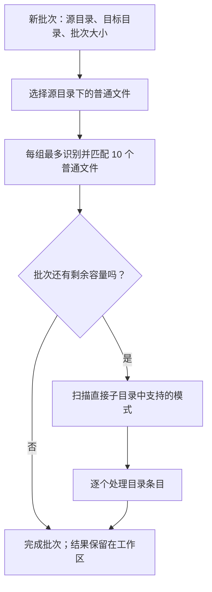
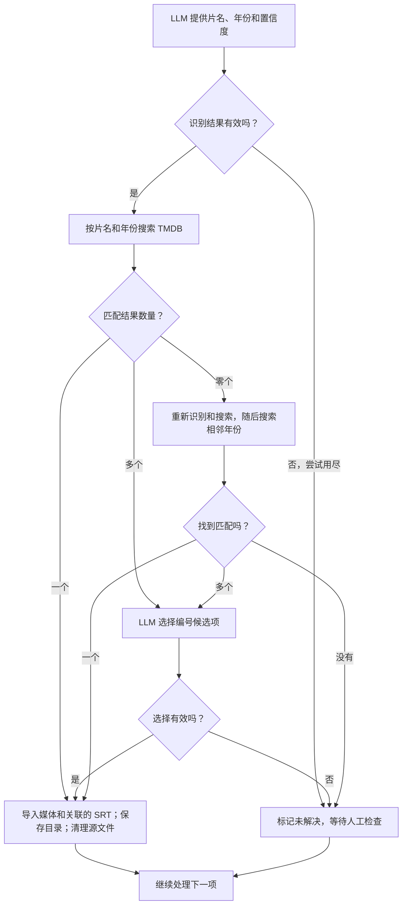

[返回文档目录](/zh-CN/) · [目录模式](/zh-CN/pages/directory-patterns/) · [导入与清理](/zh-CN/pages/import-cleanup/)

## 批次流程

用户选择 **New Batch** 后开始一个批次。R3el 首先处理源目录中的普通文件，然后扫描符合模式的直接子目录。默认目的目录是 `/exports/disk1/archive/media/movies`。

**批次大小计算的是选中项数，而不是显示的行数。** 普通文件占一个名额；符合条件的目录也占一个名额，即使其中包含多部电影。不匹配的目录保持原样。嵌套目录会被父目录的扫描包含，但不会单独排队。

## 单个条目流程

普通文件和匹配的目录条目都通过下列识别与匹配流程。每种结果最终返回批次，继续处理下一项。

为了简洁，流程图合并了重试步骤：识别有两次纠正机会；TMDB 零结果时最多重新识别三次，再按最终年份的前一年和后一年搜索。单项未解决不会阻止批次结束，但意外处理错误可能停止批次。

目录中没有年份的电影使用专门的[缺失年份流程](/zh-CN/pages/directory-patterns/)：模型通过完整文件列表推断年份或选择 No year，再查询 TMDB 并在必要时选择候选结果。无年份搜索始终返回 LLM 作选择，不进入普通零结果重试流程。

**Stop Batch** 在当前操作完成后停止。**Clear Current Batch** 如有需要先请求停止，等待工作进程释放工作区，再清除工作记录；正式媒体目录、已导入文件和 Event Log 历史不受影响。**Current Task** 显示最近一条批次事件。

另见[目录模式](/zh-CN/pages/directory-patterns/)、[导入及清理](/zh-CN/pages/import-cleanup/)和[持久化工作区](/zh-CN/pages/file-states/)。
