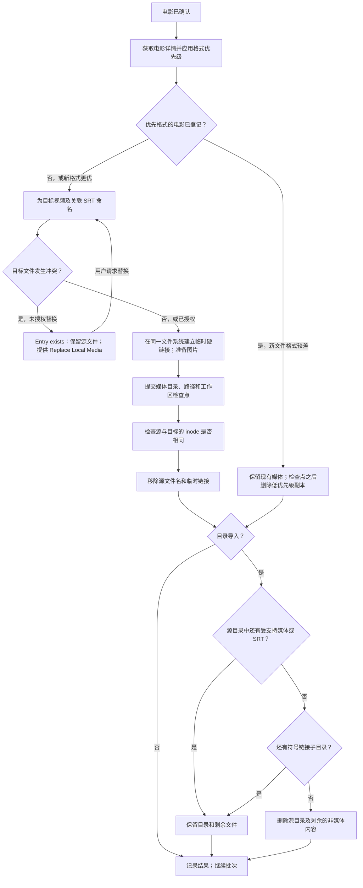

[返回文档目录](/zh-CN/) · [批次流程](/zh-CN/pages/flowchart/) · [目录模式](/zh-CN/pages/directory-patterns/)

单个 TMDB 匹配、已接受的 LLM 选择或手工输入的 TMDB ID 都可以确定待导入电影。目标名称取自 TMDB 记录中的片名和上映年份。

移动文件采用同一文件系统内的硬链接和 `unlink` 操作。**不会复制媒体字节，也不会回读内容进行验证。** 在媒体目录事务提交之前保留源文件。inode 比较基于文件系统元数据，而不是内容校验和。如果目的目录位于另一文件系统，操作会失败，不会悄悄复制。

SRT 随对应视频一起移动，并使用相同的主文件名。双文件电影使用 `Title (Year) Part 1.ext` 和 `Title (Year) Part 2.ext`，字幕使用对应的 `.srt` 文件名。参见[文件命名](/zh-CN/pages/file-naming/)。

目录清理会递归检查所有层级。源目录中只要还有任意大小的受支持视频、尚未解决的 SRT 或符号链接子目录，就不能删除该目录。否则可以删除整个目录，包括剩余的发行说明等非媒体文件。对于包含多部独立电影的目录，每导入一部便检查一次，尚未导入的电影会使目录继续保留。

流程图展示正常路径和目标冲突。文件系统或数据库错误会在提交/移除边界前保留源数据，并记录供检查的错误。按格式优先级删除副本和目标路径完全冲突是不同操作：后者必须明确使用 **Replace Local Media**。

参见[媒体目录数据库结构](/zh-CN/pages/schema/)以及[Control 和 Event Log](/zh-CN/pages/control-server/)。
